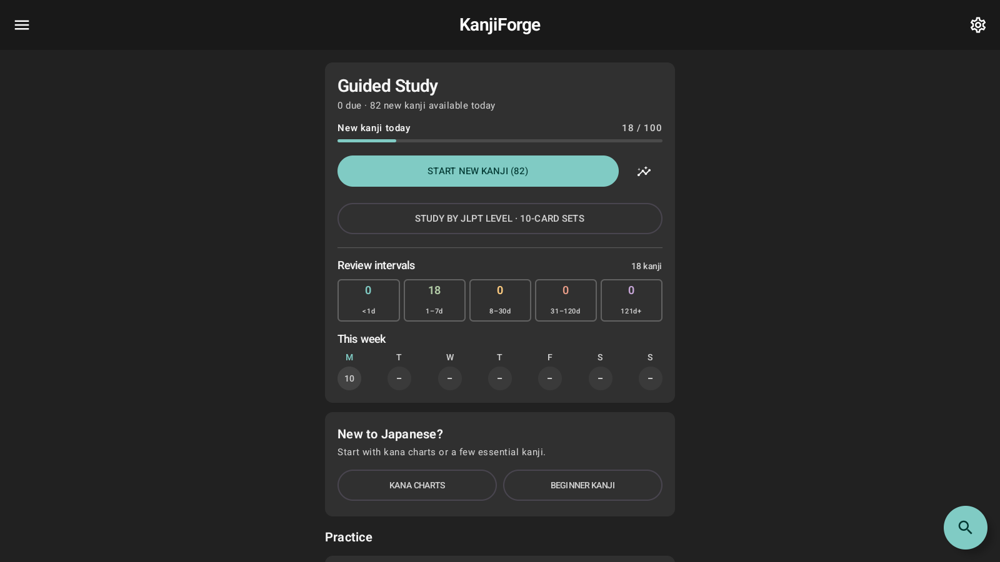
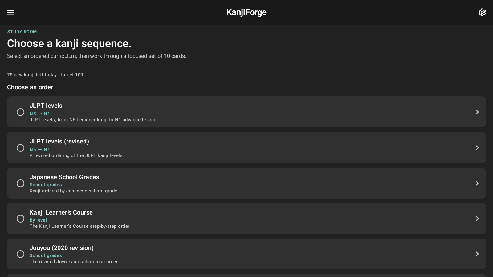
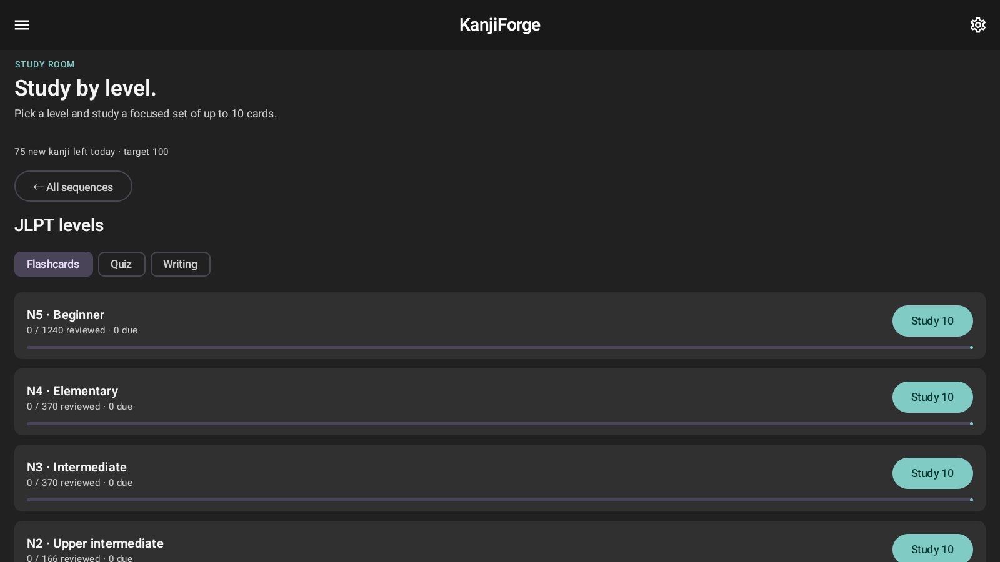
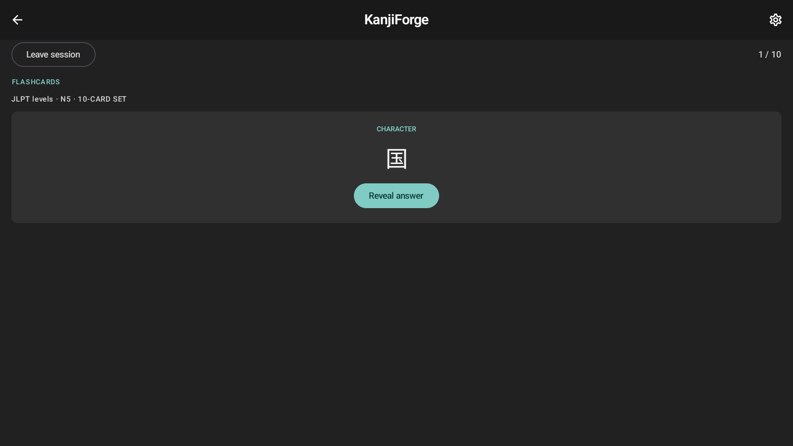

# KanjiForge

Offline-first Japanese kanji, vocabulary, and writing practice app for **Android** (Kotlin + Jetpack Compose) and **Web** (React + TypeScript).

[](https://developer.android.com/about/versions/nougat)
[](https://kotlinlang.org/)
[](https://developer.android.com/compose)
[](https://www.typescriptlang.org/)
[](https://github.com/Saurav220/Kanji-learning-app/releases/latest)
[](LICENSE)

KanjiForge keeps your entire study library and review history locally on your device — no accounts, no tracking, and zero network permissions required on Android.

---

## Download Android APK

Grab the prebuilt ARM64 Android APK from the [Latest Release](https://github.com/Saurav220/Kanji-learning-app/releases/latest):

- **Target ABI:** `arm64-v8a` (modern 64-bit Android devices)
- **Minimum OS:** Android 7.0 (API 24) or newer
- **Offline Storage:** Leave ~450 MB of free storage for first-launch extraction and verification of the bundled offline SQLite dictionary catalog
- **Permissions:** Offline-only (no `INTERNET` permission requested)

Install via ADB or by opening the APK directly on your Android device:

```bash
adb install -r KanjiForge-v1.0.0-arm64-v8a.apk
```

---

## Screenshots

| Guided Study Home | Study Sequences |
| :---: | :---: |
|  |  |
| **JLPT Level Sets** | **Flashcard Session** |
|  |  |

---

## Features

### Native Android App
- **Guided Study Home:** Daily new-kanji allowance tracker, due review counter, interval distribution (`<1d`, `1–7d`, `8–30d`, `31–120d`, `121d+`), weekly activity strip, and quick-start shortcuts for kana and beginner kanji.
- **13 Study Curricula:** Progress through JLPT levels (N5 → N1, standard and revised), Japanese school grades, Jouyou (2020 revision), Kanji Learner's Course order, Heisig, Kanken, KKLC, frequency, and more — organized into focused 10-card sets.
- **Three Study Modes:**
  - **Flashcards** with configurable prompts (Meaning → Kanji, Reading → Kanji, Kanji → Meaning) and spaced-review ratings (*Again*, *Hard*, *Good*, *Easy*).
  - **Multiple-Choice Quizzes** testing meanings and readings with optional missed-card replay.
  - **Writing Practice Pad** with touch/stylus canvas, stroke-order playback, hint overlay, and self-check grading.
- **Rich Offline Reference:** Instant local search across 7,071 kanji, 218,764 dictionary words, 16,277 example sentences, 87,950 names, 265 radicals, and 148 kana characters.
- **Custom Collections & Favorites:** Bookmark characters and words, group them into ordered custom sets, and launch study sessions directly from any collection.
- **Device Polish:** True-black AMOLED dark theme toggle, haptic feedback, Japanese reading playback via Android's system Text-to-Speech engine, and portable v2 JSON backup export/import.

### Web Companion App
- Responsive React + TypeScript PWA with offline Service Worker caching (`localStorage` persistence).
- Kanji & dictionary search with JLPT, grade, stroke count, radical, saved, and due filters.
- Interactive SVG stroke-order playback, pointer/touch drawing canvas, flashcards, multiple-choice quizzes, and v2 JSON backup compatibility with the Android app.

---

## Tech Stack

| Layer | Android App | Web App |
| --- | --- | --- |
| **Language** | Kotlin 2.2 | TypeScript 5 |
| **UI** | Jetpack Compose + Material 3 | React 19 + CSS |
| **Persistence** | Room + DataStore Preferences + SQLite FTS | Browser `localStorage` + Service Worker |
| **Serialization** | `kotlinx.serialization` | Native JSON + `CompressionStream` / `DecompressionStream` |
| **Build** | Gradle 9 + AGP 9.2 (KSP) | Vite |

---

## Project Structure

```text
.
├── app/                          # Native Android app (Kotlin + Jetpack Compose)
│   └── src/
│       ├── main/kotlin/com/kanjiforge/app/
│       │   ├── data/             # Room user DB, JSON backup, SQLite catalog bootstrap
│       │   ├── domain/           # Review scheduler, Japanese text helpers, catalog models
│       │   └── ui/               # Compose screens, navigation, drawing pad, theme
│       └── test/                 # JUnit & coroutine unit tests
├── src/                          # Web companion app (React + TypeScript)
│   ├── core/                     # Local study state, SRS intervals, search helpers
│   ├── data/                     # Compressed reference data loader & types
│   └── ui/                       # Web UI components & styling
├── public/                       # PWA manifest, Service Worker, bundled license HTML
├── scripts/                      # Deterministic open-data ingestion & packaging scripts
├── data/sources/                 # Pinned upstream dataset metadata & SHA-256 manifests
├── docs/                         # Data provenance docs & repository screenshots
├── THIRD_PARTY_NOTICES.md        # Upstream dictionary & stroke data attributions
└── LICENSE                       # MIT License
```

---

## Building from Source

### Prerequisites
- **Android:** Temurin JDK 17, Android SDK (`compileSdk 37` / `minSdk 24`), and a locally packaged `app/src/main/assets/reference/catalog.sqlite.gzbin` + `manifest.json` (generated via `scripts/package_android_reference.py`).
- **Web:** Node.js 24+ (or 20+ with Vite) and Python 3.10+ for data ingestion.

### Android Build & Tests

```powershell
# Run unit tests
./gradlew.bat :app:testDebugUnitTest

# Build debug ARM64 APK
./gradlew.bat :app:assembleDebug
```

The generated APK is written to `app/build/outputs/apk/debug/app-arm64-v8a-debug.apk`.

### Web App

```powershell
npm install
npm run dev
```

To build the production web bundle:

```powershell
npm run build
```

### Reproducing Open Language Data

Source archives and checksums are pinned in [`data/sources/metadata.json`](data/sources/metadata.json). See [`docs/data_sources.md`](docs/data_sources.md) for the exact retrieval and deterministic build steps:

```powershell
python scripts/ingest_data.py
```

---

## Third-Party Data & Attribution

KanjiForge bundles and processes open Japanese linguistic datasets:
- **KANJIDIC2 & JMdict New Generation** — Electronic Dictionary Research and Development Group (EDRDG), licensed under [CC BY-SA 4.0](https://creativecommons.org/licenses/by-sa/4.0/) with EDRDG attribution terms.
- **KanjiVG** — © Ulrich Apel, licensed under [CC BY-SA 3.0](https://creativecommons.org/licenses/by-sa/3.0/).

Full attribution details, checksums, and bundled license documents are available in [`THIRD_PARTY_NOTICES.md`](THIRD_PARTY_NOTICES.md) and [`docs/data_sources.md`](docs/data_sources.md).

---

## License

Source code in this repository is licensed under the [MIT License](LICENSE). Third-party dictionary and stroke datasets remain subject to their respective licenses.
